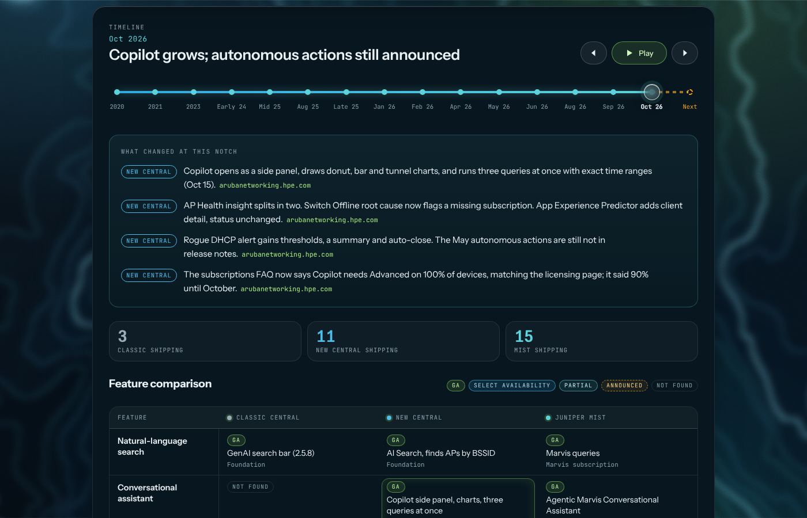

Every New Central design call I've been on this year gets to the AI slide. Copilot, autonomous actions, Marvis in Central, self-driving everything. It's a good slide and most of it is real. The question I get after it is which platform to buy for the AI, and the honest answer in October 2026 is that it depends on which AI you mean. This is my attempt to write that answer down once, with the release notes beside it, so I can point people at it instead of re-explaining it on every call.

At the end of September HPE held its [Investor Day](https://fierce-network.com/wireless/hpe-wont-merge-aruba-central-and-mist-platforms-will-share-ai-applications-and-hardware), and the networking leadership got the question every Aruba and Mist customer has been asking since the Juniper deal closed: do the two platforms merge? As reported by two outlets, the answer was no. Central and Mist stay two products, and over time they become equally capable because they share the building blocks: Marvis as the AI engine, the access points, and the CX switches. I can't link an HPE page with the quote, so treat it as press coverage. It matches what the release notes have been showing for a year, which is why I believe it, and it's good news for anyone who has both.

## What I'm using today

On my lab tenant, Copilot is the thing I reach for most. The [October 15 release](https://arubanetworking.hpe.com/techdocs/hpe-central/content/release-notes/new-capabilities-october-15th-2026.html) let it sit in a side panel next to whatever page you're on, draw its answers as donut, bar and tunnel charts, and [run three queries at once](https://arubanetworking.hpe.com/techdocs/hpe-central/content/release-notes/improvements-october-15th-2026.html) with exact date and time ranges. I asked it for clients by band.

<figure>

<figcaption>Copilot on a two-AP lab tenant, 71 seconds of thinking. The band split is right, the chart it chose is the client trend, and it appended a full client table below, which is why I cropped it.</figcaption>
</figure>

On the Mist side, my lab site has Marvis Actions with self-driving available per action. That's the screen I show customers who ask what "self-driving" means in practice: a toggle per problem type, and you decide which ones the network is allowed to fix on its own. Port Stuck and Intermittent WAN start on, DFS Optimization is always on, everything else waits for you, per Juniper's [self-driving page](https://www.juniper.net/documentation/us/en/software/mist/mist-aiops/topics/concept/self-driving-marvis-actions.html).

Those two screens are the two philosophies. Central's AI, today, is an assistant that explains the network and writes CX config for you. Mist's AI, today, is a set of actions the network takes with a human watching. Both are useful. They're useful for different customers.

## What's crossed over

The Investor Day line reads best as a description of what has already happened.

{{figure: fig-ai-swap.svg | Two features crossed over and shipped, two pieces of hardware are shared, and the announced items are still in transit.}}

In [December](https://www.hpe.com/us/en/newsroom/press-release/2025/12/hpe-disrupts-networking-with-new-ai-native-advances-for-self-driving-operations.html) HPE said Mist's Large Experience Model, the thing that correlates Zoom and Teams call quality with the network, was coming to Central. In [January](https://arubanetworking.hpe.com/techdocs/new-central/content/whats-new/2025/nov-dec.htm) the Application Experience Predictor arrived in Select Availability, which is that capability under a Central name; the Predictor's own doc doesn't say LEM, so that lineage comes from the press release, not the manual. The October notes say it has been enhanced with more client detail.

In the other direction, Mist started [managing AOS-CX switches](https://www.juniper.net/documentation/us/en/software/mist/product-updates/2026/september-9th-2026-updates.html) in September. The 5420, 6300 and 6400 families on 10.18.1002 or later show up in Wired Assurance like an EX would. For a Mist shop that already owns Aruba closets, that's the feature of the year.

The [AP 723H](https://www.hpe.com/us/en/newsroom/press-release/2026/05/hpe-moves-self-driving-networks-from-vision-to-reality-with-autonomous-networking-capabilities.html) has run on either cloud since May, and Marvis is now the name on the AI in both products.

## Where it stands this month

I got tired of re-reading release notes before every call, so I built a page that does it for me. Every New Central release note since Copilot launched, every Mist product update, and the HPE press releases behind the announcements, each capability marked as GA, Select Availability, Partial, Announced or Not Found, with the license tier the vendor documents for it. It's checked against the sources every week.

<figure>

<figcaption>The tracker. Drag the slider and watch each platform pick features up. <a href="../ai-stack.html">It lives here</a> and it's where the figures in this post come from.</figcaption>
</figure>

{{figure: fig-ai-scorecard.svg | Twelve capabilities, three platforms, October 2026. Shape is status, small text is the tier.}}

Read down the columns and the two philosophies show up again. Central: the assistant, natural language to CLI, the Agentic-Mesh pills that turn an 802.11r problem into a recommendation, all GA, all on Advanced. Mist: nine self-driving actions, Minis running synthetic tests from the APs and now the EX switches, and a NAC dry run that lets you test an Access Assurance policy before it enforces. Classic Central keeps search and AI Insights and is handing the rest to New Central on a schedule that [hasn't been published](https://arubanetworking.hpe.com/techdocs/hpe-central/content/frequently-asked-questions-faq/day-2-workflow-migration-from-hpe-classic-central-faq.html).

## What I'm waiting on

In May HPE announced five autonomous actions for both platforms: Dynamic Capacity Optimization, Missing VLAN, Rogue DHCP protection, real-time DFS and Client Roaming Optimization. No dates per platform, which is normal for an announcement. Here's where each one is five months later.

{{figure: fig-ai-ladder.svg | Four of the five are shipping on Mist. On Central they're still on the announced list, which is where I'm watching.}}

Mist had three of them in [April](https://www.juniper.net/documentation/us/en/software/mist/product-updates/2026/april-15th-2026-updates.html), before the announcement, and added Missing VLAN in September. Central's October release improved the Rogue DHCP Server alert with thresholds, a summary and auto-close, which is a better alert and a sensible step toward the autonomous version. The five actions themselves, and the Marvis wired port remediation HPE listed for Central at [Discover](https://www.hpe.com/us/en/newsroom/press-release/2026/06/hpe-expands-self-driving-networks-across-edge-campus-data-center-and-ai-factories.html), haven't reached a Central release note as of October 15.

Why I care: my Aruba customers are the ones who'd benefit most. A campus on CX and AOS 10 with a small IT team is exactly where Missing VLAN and Rogue DHCP fixing themselves pays off, and today that customer has to buy the Mist experience to get it. When those land in Central, the recommendation changes for a lot of accounts, and I'd like to be ready for that week rather than reading about it afterwards. That's what the tracker is for.

## Counting your tenant

There's no Copilot SKU. After the 90-day trial, Copilot and Agentic-Mesh need an Advanced subscription on 100 percent of the devices in the account. That's on the [Copilot licensing page](https://arubanetworking.hpe.com/techdocs/hpe-central/content/operations/networking-copilot-licensing.html) and, as of this month, on the [subscriptions FAQ](https://arubanetworking.hpe.com/techdocs/hpe-central/content/frequently-asked-questions-faq/subscriptions-faq.html) too; the FAQ said 90 percent until recently and an older copy under the previous doc tree still does. The 90 percent rule now applies only to the three insights that need Advanced. One Foundation switch in a tenant is enough to hold Copilot back, so it's worth counting before the demo. October added Subscription Tier as its own inventory column, so the count is a filter now instead of a spreadsheet.

Mist prices it as an add-on per capability: Wireless Assurance, Marvis, Premium Analytics. Minis and the self-driving actions ride on the Marvis subscription with no extra SKU. More line items, less to explain.

## What I can build now

None of this needs me to wait on anything. Both clouds have public APIs, and the four tools below are Postman collections and short Python scripts, not AI.

**Copilot readiness check.** The New Central API's device inventory already carries the subscription tier per device. A script that pulls every device, counts Foundation versus Advanced, and prints the gap to 100 percent per tenant turns the licensing question into a number on the first call instead of a surprise on the demo. Run it before every Copilot conversation.

**Mist self-driving audit.** The Mist API exposes Marvis Actions and their self-driving settings per site. A monthly pull that lists which actions are enabled where, flags sites still in recommend mode, and exports the AI Validated history gives a customer a one-page record of what the network fixed on its own. That page is the thing that gets the next action turned on.

**Release-note watcher.** The job behind the tracker page already diffs the Central release notes and Mist product updates every week. Filtered per customer, so a Mist-only shop never hears about Copilot and an Aruba campus gets a note the week Missing VLAN reaches Central, it becomes a service rather than a blog page.

**Roaming report.** October added CSV export of roaming and association events per client in Central. Piped through a short script that groups by floor and AP pair, it's a roam-quality report I can hand over after a survey, and a baseline to compare against when Client Roaming Optimization ships.

Each of those is a follow-up post with the code. This one is the map.

## Bottom line

Central and Mist are two platforms sharing one AI engine, one AP family and one switch line, and HPE said so out loud at Investor Day. Central's AI is an assistant and it's here. Mist's AI is autonomy and it's here. The autonomous actions announced for Central in May are the next thing I'm watching for, because they'd change the recommendation for a lot of Aruba customers. Pick by the problem the customer actually has, count the tenant before promising Copilot, and keep the [tracker](../ai-stack.html) open.
