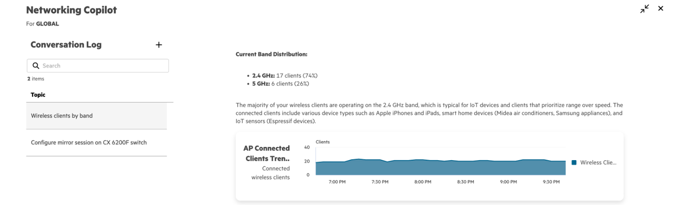

Every New Central design call I've been on this year gets to the same slide. Copilot, autonomous actions, Marvis inside Central, self-driving everything. It's a good slide. Then somebody asks which platform they should buy for the AI, and I've learned to answer with a question of my own: which of those features did you see in a release note, and which did you see on a stage?

At the end of September HPE held its Investor Day, and the networking leadership was asked the question every Aruba and Mist customer has been asking since the Juniper deal closed. Do the two platforms merge? The answer, as reported by two outlets, was that they don't. Central and Mist stay two products. What they share is Marvis as the AI engine, the access points, and the CX switches. I can't link you to an HPE page that says it, because there isn't one yet, so take it as press coverage rather than a vendor statement. It matches what the release notes have been saying for a year, which is why I believe it.

Two weeks after that, on October 15, New Central shipped its monthly release. It's a real release with real Copilot work in it. It also contains none of the five autonomous actions HPE announced for both platforms back in May. That gap is the post.

## What "share Marvis" means in practice

The useful way to read the Investor Day line is as a description of what has already happened, not a plan.

{{figure: fig-ai-swap.svg | Two features crossed over and shipped, two pieces of hardware are shared, and the promises are still dashed lines.}}

In December HPE said Mist's Large Experience Model, the thing that correlates Zoom and Teams call quality with the network, was coming to Central. In January the Application Experience Predictor arrived, which is that capability under a Central name; HPE's doc for it doesn't say LEM, so that lineage is the press release's, not the manual's. It launched in Select Availability and the October notes say it has been "enhanced" with more client detail. There's still no release note calling it GA, and I couldn't find a documented AOS 10 or license requirement for it. That's one feature, one direction.

In the other direction, Mist started managing AOS-CX switches in September. The 5420, 6300 and 6400 families on 10.18.1002 or later show up in Mist Wired Assurance like an EX would. That's a bigger deal than it sounds, because it means a Mist shop can keep buying the Aruba switch its cabling closets were designed around.

The AP 723H has run on either cloud since May. And Marvis is now the name on the AI in both products.

What hasn't crossed over is the part the slide leads with. Marvis Actions in Central were called available at Discover in June. No Central release note has shown them. The "agentic mesh" that was introduced for Central in 2025 has, per one executive quoted after Investor Day, moved to Mist. No Mist product update shows it under that name either. Those two are the dashed lines on the figure, and I'd keep them dashed until a release note says otherwise.

## The scorecard, as of today

I keep a data file for this. Every New Central release note since the Copilot launch, every Mist product update, and the HPE press releases behind the announcements, each capability marked as GA, Select Availability, Partial, Announced or Not Found, with the license tier the vendor documents for it. Here's where it stands.

{{figure: fig-ai-scorecard.svg | Twelve capabilities, three platforms, October 2026. Shape is status, small text is the tier.}}

The pattern is obvious once it's on one page. Central's AI story is Copilot: the assistant, the natural-language-to-CLI, the Agentic-Mesh pills that turn an 802.11r problem into a recommendation. All of that is GA and all of it needs Advanced. Mist's AI story is autonomy: nine self-driving actions, Minis running synthetic tests from the APs and now the EX switches, and a NAC dry run that lets you test an Access Assurance policy before it enforces. Classic Central has search and AI Insights and is losing the rest to New Central on a date nobody has published.

Neither column is wrong for every customer. They are different products with different ideas about what AI in a network should do, which is exactly what Investor Day said.

## Announced versus shipped

In May HPE announced five autonomous actions for both platforms: Dynamic Capacity Optimization, Missing VLAN, Rogue DHCP protection, real-time DFS and Client Roaming Optimization. No dates per platform. Here's the ladder five months later.

{{figure: fig-ai-ladder.svg | Four of five shipped on Mist, three of them before the announcement. Zero of five in Central's release notes.}}

Mist had three of them in April, a month before the press release, and added Missing VLAN in September. Central has none of them through October 15. What Central's October release did do is improve the Rogue DHCP Server alert, with thresholds, a summary and auto-close. That's a better alert. It is not the autonomous fix from May, and the release note doesn't claim it is.

I want to be fair about what did ship. Copilot can now sit in a side panel next to whatever page you're on, draw its answers as donut, bar and tunnel charts, run three queries at once, and take exact date and time ranges. I tried it on the lab tenant.

<figure>

<figcaption>Copilot on a two-AP lab tenant, after 71 seconds of thinking. The answer is right, the chart is the client trend rather than the band split I asked for, and the client table it appended below is why I cropped it.</figcaption>
</figure>

That's a better Copilot. It's still an assistant, which is what it's meant to be. The thing that recommends and the thing that acts on its own are different products, and only one of them has shipped on the Central side.

## The licensing footnote

There is no Copilot SKU. After the 90-day trial, Copilot and Agentic-Mesh need an Advanced subscription on 100 percent of the devices in the account. That's the Copilot licensing page and, as of this week, the subscriptions FAQ too; the FAQ said 90 percent until recently, and an older copy of it under the previous doc tree still does. The 90 percent figure now applies only to the three insights that need Advanced. A tenant that mixes Foundation on the switches with Advanced on the APs won't light up what the demo showed, and one Foundation switch is enough.

The October release at least made the count easy. Device inventory now shows Subscription Tier as its own column, so you can filter for Foundation and see what's holding you back. If a quote hinges on it, get the current number from HPE in writing, because that page has moved once already.

Mist prices it the other way, an add-on per capability. Wireless Assurance, Marvis, Premium Analytics. Minis and the self-driving actions ride on the Marvis subscription with no extra SKU. It's more line items and less ambiguity.

## What I tell customers

If the estate is Aruba and the ask is an assistant that explains the network in English and writes CX config for you, New Central is the answer and the AI is here today. Budget for Advanced on everything and treat the autonomous actions as roadmap until they're in a release note.

If the ask is a network that fixes known problems on its own, with a human watching, Mist is the one that does it today, and it now manages the CX switches most Aruba shops already own. Run every action in recommend mode first, then turn them on one site at a time. Mist's own defaults are a good hint: Port Stuck and Intermittent WAN start on, the rest start off, and DFS Optimization is the one you can't turn off.

If the estate is Classic Central, the AI conversation is really the migration conversation. Classic keeps onboarding and config. Monitoring, troubleshooting and AI operations are moving to New Central on a schedule HPE hasn't published.

And if someone shows you a slide, ask for the release note. I made that easier on myself with a page that keeps the whole table current, checked every week against the Central release notes and the Mist product updates, with a timeline you can drag through to watch each platform pick features up. [It's here](../ai-stack.html), and it's where the figures in this post came from.

## Bottom line

HPE said it plainly at Investor Day, and the release notes had been saying it for a year: Central and Mist are two platforms that share an AI engine, an AP family and a switch line. Central's AI is an assistant and it has shipped. Mist's AI is autonomy and it has shipped. The five autonomous actions promised for Central in May are still announced rather than released as of October 15, 2026. Buy the one that does what the customer actually asked for, and read the release note before the keynote.
